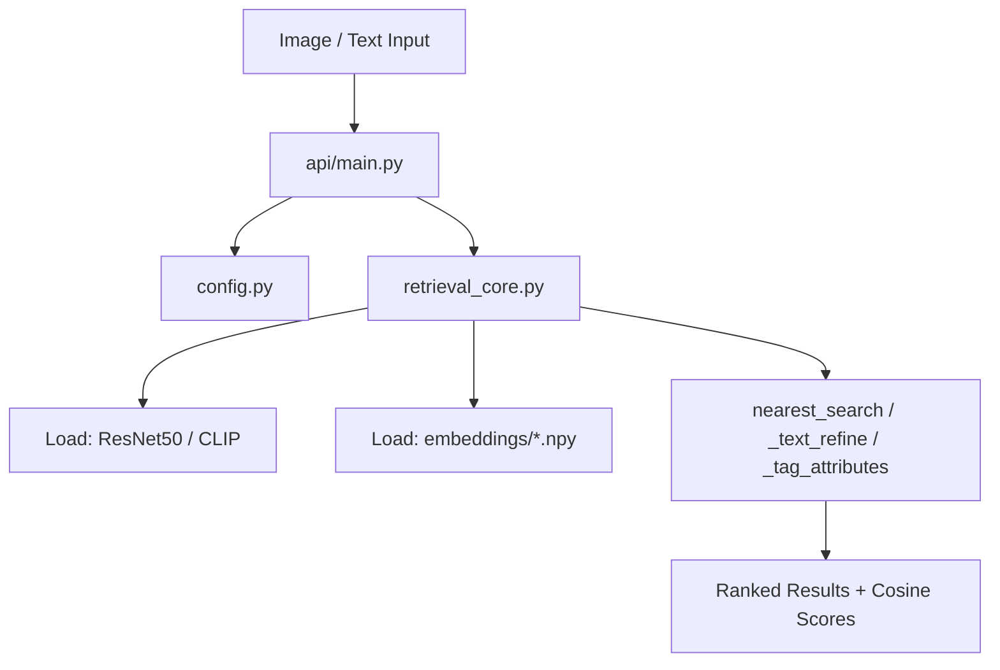

# StyleLens: Validation, Git, and Multi-Cloud Deployment Guide

This document provides a step-by-step manual to validate, test, and package the standalone **StyleLens Retrieval Core** project, set up Git cleanly, and deploy it across major cloud platforms.

---

## 1. Code-Level Architecture & Flow

Understanding how the modules interact:



### Critical Modules:
* **`config.py`**: Controls global parameters. Update `DATASET_BASE_PATH` if your DeepFashion database directory changes.
* **`retrieval_core.py`**: Mathematical and deep learning engine.
  * `l2_normalize(v)`: **Critical Step.** L2-normalization scales vectors to unit length. This makes the dot product ($A \cdot B$) mathematically equivalent to cosine similarity, enabling lightning-fast brute force search via matrix multiplication (`query_emb @ gallery_emb.T`).
  * `nearest_search(query_emb, gallery_emb, top_k)`: Performs the cosine calculation and maps indices back to actual image file paths.
  * `_text_refine(candidates, user_query)`: Implements cross-domain re-ranking. Combined Score = $0.7 \times \text{Visual Similarity} + 0.3 \times \text{CLIP Text Similarity}$.

---

## 2. Step-by-Step Validation & Evaluation Plan

Follow these steps to confirm code-level correctness by running automated unit tests for each file.

### Step 2.1: Create the Test Suite (`tests/` directory)
Create a new directory structure `tests/` in the root of the project to validate the files individually.

```
StyleLense/
├── tests/
│   ├── test_config.py
│   ├── test_fashion_ds_processing.py
│   ├── test_embeddings.py
│   └── test_api.py
```

### Step 2.2: Unit Test Details for Each File

#### A. Testing `config.py` (`tests/test_config.py`)
Validate that paths exist and directories are generated properly:
```python
import os
import config

def test_config_paths():
    assert hasattr(config, "DATASET_BASE_PATH")
    assert hasattr(config, "EMBEDDINGS_DIR")
    # Verify auto-directory creation
    assert os.path.exists(config.EMBEDDINGS_DIR)
    assert os.path.exists(config.UPLOAD_FOLDER)
```

#### B. Testing `fashion_ds_processing.py` (`tests/test_fashion_ds_processing.py`)
Validate dataset class structures and data formatting properties:
```python
import pytest
import torch
from fashion_ds_processing import FashionDataset

def test_fashion_dataset_init():
    # Verify dataset initialization raises appropriate exceptions if files are missing
    with pytest.raises(Exception):
        FashionDataset(base_path="/invalid/path")
```

#### C. Testing `retrieval_core.py` (`tests/test_embeddings.py`)
Verify vector mathematics ($L_2$ normalisation and cosine dot product):
```python
import numpy as np
import retrieval_core as utils

def test_l2_normalization():
    v = np.array([3.0, 4.0])  # Length is 5.0
    v_norm = utils.l2_normalize(v)
    assert np.allclose(v_norm, np.array([0.6, 0.8]))
    # Check that unit length is exactly 1.0
    assert np.allclose(np.linalg.norm(v_norm), 1.0)

def test_nearest_search_exact_match():
    # A vector matched with itself must score 100% (or 1.0) and be ranked first
    query = np.array([[1.0, 0.0]])
    gallery = np.array([[1.0, 0.0], [0.0, 1.0]])
    results = utils.nearest_search(query, gallery, top_k=1)
    assert results[0]["rank"] == 1
    assert results[0]["similarity"] == 100.0
```

#### D. Testing `api/main.py` (`tests/test_api.py`)
Verify API status codes and payloads using FastAPI's `TestClient`:
```python
from fastapi.testclient import TestClient
from api.main import app

client = TestClient(app)

def test_health_endpoint():
    response = client.get("/health")
    assert response.status_code == 200
    data = response.json()
    assert data["status"] == "healthy"
```

### Step 2.3: Execute the Test Suite
Run the automated test suite using `pytest`:
```bash
/Users/anushrin/Documents/Cowork Playground/FashionRecommendation/workspace/Capstone Fashion Assistant/fashion_assistant/venv312/bin/pytest tests/ -v
```

### Step 2.4: Evaluate Recall Metrics
Validate model performance on the test split using precomputed embeddings:
```bash
/Users/anushrin/Documents/Cowork Playground/FashionRecommendation/workspace/Capstone Fashion Assistant/fashion_assistant/venv312/bin/python scripts/evaluate_retrieval.py
```
* **Verify**: Confirm that it lists metrics for `clip_base` and your custom-trained variants.

### Step 2.5: Interactive Local UI Validation
Start the FastAPI server:
```bash
/Users/anushrin/Documents/Cowork Playground/FashionRecommendation/workspace/Capstone Fashion Assistant/fashion_assistant/venv312/bin/uvicorn api.main:app --reload --port 8000
```
1. Open **`http://localhost:8000`** in your browser to test the visual search flow. Upload an image, check refinement, and confirm the resulting grid load behaves as expected.

---

## 3. Git Repository Setup & Best Practices

Before pushing code, we must prevent large files from cluttering your repository:

### Step 3.1: Create `.gitignore`
Create a `.gitignore` file inside `StyleLense/` to exclude large model files, database files, and virtual environments:
```ini
# Byte-compiled / optimized / DLL files
__pycache__/
*.py[cod]
*$py.class

# Environments
.venv/
venv/
venv312/
ENV/

# Large Model weights and Embeddings (Crucial!)
StyleLense/embeddings/*.npy
StyleLense/embeddings/*.bin
StyleLense/models/clip_best/
StyleLense/models/resnet50_best.pth
StyleLense/models/resnet50_finetuned.pth

# Data
StyleLense/data/
uploads/

# OS files
.DS_Store
```

### Step 3.2: Initialize and Commit
```bash
git init
git add .
git commit -m "feat: init standalone stylelens retrieval core"
```

> [!NOTE]
> Since `.npy` embedding databases and `.pth` weight models are gitignored, you should store them in a cloud storage bucket (e.g. AWS S3, Google Cloud Storage, or Hugging Face Models repo) and write a bootstrap script to download them during pipeline execution.

---

## 4. Multi-Cloud Deployment Guide

### A. Google Cloud Platform (GCP) — Google Cloud Run
Cloud Run is ideal for hosting FastAPI apps in serverless, auto-scaling containers.

1. **Write a `Dockerfile`**:
   ```dockerfile
   FROM python:3.12-slim
   WORKDIR /app
   RUN apt-get update && apt-get install -y libgl1-mesa-glx libglib2.0-0 && rm -rf /var/lib/apt/lists/*
   COPY requirements.txt .
   RUN pip install --no-cache-dir -r requirements.txt
   COPY . .
   EXPOSE 8080
   CMD ["uvicorn", "api.main:app", "--host", "0.0.0.0", "--port", "8080"]
   ```
2. **Build and Deploy**:
   ```bash
   gcloud builds submit --tag gcr.io/[PROJECT_ID]/stylelens-api
   gcloud run deploy stylelens-api --image gcr.io/[PROJECT_ID]/stylelens-api --platform managed --allow-unauthenticated --memory 4Gi
   ```

---

### B. Amazon Web Services (AWS) — App Runner / ECS Fargate
AWS App Runner provides the fastest deployment from Docker images.

1. Build your Docker image and push it to **AWS ECR** (Elastic Container Registry).
2. Create an **App Runner Service** pointing to the ECR image URI.
3. Configure the container port to `8080` and provision at least `4 GB RAM` (since loading CLIP and ResNet50 models in CPU RAM requires sufficient memory).

---

### D. Hugging Face Spaces (Docker SDK)
Hugging Face allows hosting web apps for free using their hardware options.

1. Create a new Space on Hugging Face, choosing **Docker** as the SDK.
2. Push your repository. Hugging Face will automatically read the `Dockerfile` and expose port `7860` (change your uvicorn launch command in the Dockerfile to `--port 7860`).

---

### E. Vercel / Netlify
Vercel is tailored for static frontends and tiny Node.js/Python serverless functions.
* **Warning**: Vercel Serverless Functions have a strict **50MB size limit** and **10-second timeout** in the hobby tier. Loading PyTorch/CLIP models takes too long and exceeds the size limit.
* **Recommendation**: Keep the HTML frontend on Vercel, but host your Python similarity search API on **Cloud Run**, **Render**, or **Hugging Face**, making fetch calls from your frontend to that API.
